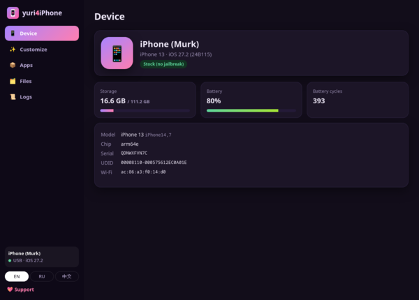
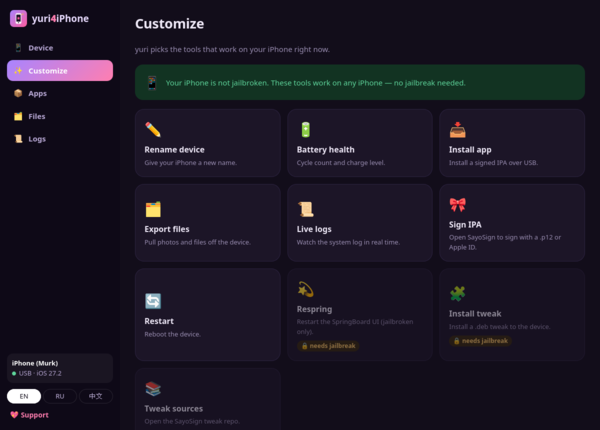

<p align="center"></p>
<h1 align="center">yuri4iPhone</h1>
<p align="center">
  <b>A friendly iPhone toolbox for your computer — like 3uTools, but open, cross-platform and cute.</b><br>
  Works on <b>Linux, Windows and macOS</b>. Jailbroken or not — yuri shows you only the tools that work on your device.
</p>
<p align="center">
  <a href="README_RU.md">Русский</a> · <a href="README_ZH.md">简体中文</a> ·
  <a href="https://github.com/murk-sus/yuri4iPhone/releases/latest"><b>⬇ Download</b></a>
</p>
<p align="center">
  
  
</p>

## What it does

- **📱 Device dashboard** — model, iOS, storage, **battery level, cycle count & health**, serial, UDID, chip, Wi-Fi — live over USB or Wi-Fi.
- **✨ Customize** — the headline feature: yuri detects whether your iPhone is **stock, TrollStore or jailbroken**, and **unlocks exactly the tools that work** on it. No guessing, no bricking — jailbreak-only tools are clearly locked with a reason on a normal device.
- **📦 Apps** — list your apps and system apps, uninstall, and **install a signed IPA** over USB with a live progress bar.
- **🗂️ Files** — browse the media partition (photos, downloads, recordings) and pull files off the device.
- **📜 Live logs** — watch the system log in real time with a filter.
- `EN · RU · 中文`, light & dark.

Everything runs locally on a `127.0.0.1` server with a fresh token each launch. Your device never talks to any cloud.

## Install

**Linux**
```sh
git clone https://github.com/murk-sus/yuri4iPhone && cd yuri4iPhone
./install-linux.sh
yuri4iphone
```
Needs `usbmuxd` (Arch: `pacman -S usbmuxd`, Debian/Ubuntu: `apt install usbmuxd`) and Python 3.10+.

**Windows / macOS** — grab a build from [Releases](https://github.com/murk-sus/yuri4iPhone/releases). On Windows, install iTunes or Apple Devices so the iPhone driver is present.

**From source (any OS)**
```sh
pip install .            # or: pip install '.[window]' for a native window
yuri4iphone
```

## Why "yuri4iPhone"

Because the tool should pick the right thing *for* you. Part of murk's iOS toolkit, next to
[SayoSign](https://github.com/murk-sus/SayoSign) (on-device signer) and [IPALens](https://murk-sus.github.io/IPALens/) (inspect any IPA).

## 💖 Support

Free and MIT licensed. If it saved you time: **[donate page with QR codes](https://murk-sus.github.io/donate/)** (USDT TRC20, TON, BTC, ETH, SOL) · Telegram [@jailbreak_IOS_and_tweaks](https://t.me/jailbreak_IOS_and_tweaks)

MIT © murk. Built on [pymobiledevice3](https://github.com/doronz88/pymobiledevice3). Not affiliated with Apple. "3uTools" is a trademark of its owner; yuri4iPhone is an independent, unrelated project.
